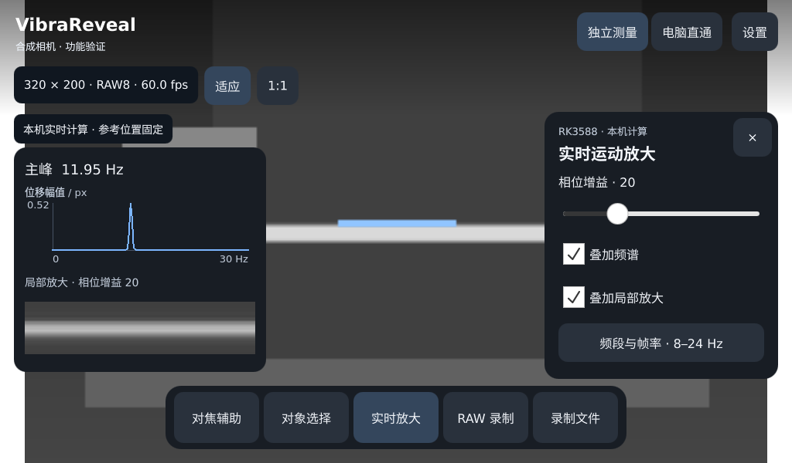

# RK3588 Qt 5.15.10：CNB 构建与板端验证

日期：2026-11-01。应用基于 `9ab050b7d8a329d9162e5c84bc35879eb45dcc7e` 加本次触屏程序变更构建；精确二进制身份见附带 JSON。未替换开发板系统 Qt、Mali 或内核。

## SDK 与构建

- 已发布 `docker.cnb.cool/fu1fan/vibrareveal/qt-app-sdk@sha256:1ad1117388be3cccfd4607aa7003768b5ed2c9f8b94e4572f7d815b5d76bb1e4`，仓库 `10-env/sdk.lock.json` 固定此摘要。
- 基础系统 SDK 为 `d2a21493198e25881cb03144bf4dd45b76e773e6cbbad1b62d6debbd4aa73cef`，系统提交 `ac7c05413b3882f578cb94be4b2edfe3958d84c6`。
- 从用户的原厂资料中找回完整 SDK archive，SHA-256 `4a5c3e6deba91a6556917efab471dbffe6beb6c5b6cbb01ec1ffdb3f07b88ea8`。
- Qt Core/Gui/Qml/Quick/QuickControls2/QuickTemplates2 的 ELF 可加载节逐一与实际板端库匹配；完整文件因剥离信息不同而有不同哈希。匹配记录见 [qt-runtime-match.json](rk3588-touch-2026-11-01/qt-runtime-match.json)。
- 补齐 Qt 5.15.10 目标头文件、CMake 包、QML、mkspecs、amd64 moc/rcc/qmake/qmlcachegen；保留基础 SDK 的目标 Qt 库。qmake 原厂路径和 Mali 开发静态库也已补齐。
- 在 CNB 的 Linux/amd64 工作区构建，Qt 版本严格 EXACT 5.15.10；SDK 换目录后重新编译链接成功。镜像发布后通过 `elf2-sdk` 提取到 digest 缓存，再通过 `check-qt.sh sdk` 和完整触屏应用构建。
- AArch64 ELF 动态加载板端现有 `/lib/libQt5*.so.5`、`libstdc++.so.6`、Mali 和 Vulkan。GCC 10.3.1 编译器的库搜索顺序已修正，优先目标 sysroot 的 C++ 运行库，避免旧 bundled libstdc++ 无法满足 Qt/ICU 的符号要求。

构建入口：

```sh
sh 10-env/check-qt.sh sdk
sh 10-env/build-touch-app.sh /tmp/vr-touch-build \
  -DVR_BUILD_RKNN_SELECTION=ON -DBUILD_TESTING=ON
```

[构建身份](rk3588-touch-2026-11-01/touch-build-info.json) 中 `board_runtime_verified: false` 表示构建脚本自身不冒称板端验证；本记录及板端日志提供独立的运行证据。

## 原板运行结果

板端 Linux 5.10.209，Qt 5.15.10，Weston/Wayland，8 GiB DDR；使用 `/dev/video11` 与 `/dev/v4l-subdev2`。

| 检查 | 结果与范围 |
| --- | --- |
| 原生加载 | 使用板端 Qt/Controls2、Wayland 与 Mali，1024×600 界面截图可读 |
| 核心测试 | 录制、内存压力注入、磁盘错误注入、频谱、边缘测量、VRI1 传输通过 |
| Vulkan 测试 | 实时算法、非法配置/帧、采样缺口、边缘特征及完整片段离线处理通过，使用真实 Mali GPU |
| Qt 界面流程 | 对焦锁定 1:1、拖动坐标映射、录制/保存/回放、选对象/边缘、离线分析、局部放大/频谱及直通切换通过；此流程使用明确标记的合成源 |
| 合成频谱 | 板端实际 GPU 计算得到 11.95 Hz，测试信号为 12 Hz |
| 真实相机 | 1280×800、RAW10、stride 2560、传感器 120 fps，预览序号前进、峰值图生成 |
| 真实录制 | 约 2 秒保存 242 帧；读取全文件验证每帧 CRC、连续性和 END，再在应用回放通过 |
| USB 直通至 Mac | 155 帧、317,440,000 payload bytes，源 120 fps，约 245.19 MB/s；序号缺口 0、发送队列丢帧 0，双方完成结束握手；Mac 保存文件再读取验证通过 |
| 正式启动入口 | `/usr/local/sbin/vr-touch-launch` 使用真实相机运行 10 秒，截图保存并正常退出 |

日志：[后端测试](rk3588-touch-2026-11-01/backend-tests.log)、[SDK 消费构建](rk3588-touch-2026-11-01/sdk-consumer.log)、[qmake 消费构建](rk3588-touch-2026-11-01/qmake-consumer.log)、[界面流程](rk3588-touch-2026-11-01/ui-workflow.log)、[真实相机与 USB](rk3588-touch-2026-11-01/hardware-capture.log)、[Mac 接收统计](rk3588-touch-2026-11-01/mac-usb-receive.json)、[正式启动](rk3588-touch-2026-11-01/installed-app.log)。相机现场截图仅保留在本地，不上传仓库。



## 本次板端发现并修复的问题

- 原板 QML 编译器处理面板默认内容别名时崩溃，改为 Qt Controls `Pane` 的内容容器。
- 原厂 Fusion `ProgressBar.qml` 在正式程序中触发 QML 编译器崩溃；正式程序与测试统一使用 Default 控件，并保留自定义高对比样式。
- Vulkan 管线初始化超过两个帧周期会误触发测量队列满。初始化期间只保留最新待处理帧，初始化完成后建立连续测量窗口；测量开始后仍保留队列与采样缺口检查。
- 原板已有 Weston，启动器优先使用 Wayland；触屏着色器安装到独立目录，避免覆盖既有 CLI 着色器。
- 调整底部按钮宽度，保证“RAW 录制”完整单行显示。

## 安装和恢复

已安装 `/usr/local/bin/vr-touch`、`/usr/local/sbin/vr-touch-launch` 和 `/usr/local/share/vibrareveal-touch/motion.comp.spv`。原 USB 采集服务在每次测试结束后恢复；未更改开机默认程序。

```sh
/etc/init.d/S91vrstream stop
/usr/local/sbin/vr-touch-launch --storage /root/vibrareveal/recordings
# 退出应用后恢复原服务：
/etc/init.d/S91vrstream start
```

原板 `/userdata` 分区约 1 GiB，根 eMMC 分区约 57 GiB；本次录制放在根分区，避免小分区影响验证。

可显式运行硬件测试，必须先停止占用相机的服务：

```sh
QT_QPA_PLATFORM=wayland XDG_RUNTIME_DIR=/run \
VR_TEST_CAMERA=1 VR_TEST_STORAGE=/root/vr-touch-validation/recordings \
VR_TEST_SHADER_PATH=/root/vr-touch-validation/motion.comp.spv \
VR_UI_CAPTURE_DIR=/root/vr-touch-validation/screenshots \
./vr-touch-ui-test hardwareCapture
```

额外设置 `VR_TEST_USB=1` 会重新枚举 USB 并验证电脑直通；同时在 Mac 运行 `vr-receive --usb --timeout 30 --output capture.vri`。测试结束后恢复原相机服务。

## 尚未覆盖

人工手指触摸/拖动与触控校准、真实振动物体的位移/频率标定、NPU 模型推理、持续长时间采集和温升、实际填满 4 GiB DDR/磁盘、反复 USB 插拔。压力停止逻辑已由依赖注入测试验证，不等同于上述实机压力验收。此次真实场景未测量振动精度，USB 数据量只支持短程功能与吞吐冒烟结论。

## 人工试用反馈修复：浅色界面、直通退出与对焦帧率

- 补齐左上角四条波形 Logo；面板、按钮、文件列表和频谱按 HTML 演示的浅色配色实现，深色相机状态标签保留高对比白字。
- 复现了等待电脑时返回独立测量产生 `USB session cancelled` 的问题。接收握手前的主动停止现在归类为正常取消；开始传输后的失败仍保留错误语义。直通会话不再借用独立模式的文件传输横幅。
- 原对焦每帧执行完整 Vulkan 对象分析，包含不需要的法向、区域扩张及回读。改为复用工作缓冲的全分辨率 CPU Gaussian/Sobel/NMS 路径，保留 RAW 精度、反射边界和灵敏度约定；对象选择与运动测量仍使用原后端。
- 板端 RAW8/10/12/16 测试图与原 Vulkan 峰值图逐像素对照，每种格式 12,288 像素、差异均为 0；平坦图无伪峰值。此结果不代表任意浮点临界值都逐位相同。
- 在同一开发板、Qt 5.15.10/Wayland、1280×800 RAW10、真实相机上，以 3 秒窗口测量：旧对焦交付 7.67 个新画面/秒；新版约 40.97 个/秒。普通预览最新一次交付 38.31 个/秒，计算端约 60 fps；屏幕交换约 58.96 fps 不等于对焦图像更新率。对焦提示现在直接显示新画面交付帧率。
- 预览最多处理约 60 fps，原始采集、录制与直通提交仍使用每个传感器帧；新版实机约 2 秒录制 241 帧，120 fps 格式、全文件 CRC/连续性/END 及回放通过。本次没有重复 Mac USB 吞吐测试。

复现测试为 `vr-touch-ui-test focusPeakingParity hardwarePreview hardwareCapture workflow`，硬件环境变量同上；`hardwarePreview` 增加 30 个新画面/秒的回归门槛。日志见 [旧版基线](rk3588-touch-2026-11-01/preview-baseline.log)、[修复后测试](rk3588-touch-2026-11-01/touch-fix-final.log) 和 [核心测试](rk3588-touch-2026-11-01/touch-fix-core.log)。相机现场截图仍仅保存在本地。

本轮应用 SHA-256：`f1389326480e684b5dc0ff3856fd6ac6895dc6483493d9e27169d7ef9cb340ce`。旧应用备份在板端 `/root/vr-touch-validation/vr-touch-before-ui-fixes`。为继续人工试用，原采集服务暂停，修复后的正式触屏程序保持运行；开机配置不变。

## 演示图标移植

将 HTML 中的 17 种 Lucide 图标全部接入对应功能：模式切换、设置、底部五个工具、关闭、频段入口、停止录制、分析/传输、播放/暂停和电脑连接状态；补上相机就绪圆点。底部工具采用图标在上、文字在下，图标按钮保留至少 50 px 热区及无障碍名称。

使用 Lucide Static 0.468.0 的 SVG 几何，以产品颜色生成固定变体，图标和许可证嵌入 QRC；利用原板已有 Qt 5.15.10 SVG 插件，离线可用，无需安装字体或联网下载。来源、许可和对应关系见 `03-apps/rk3588/qml/icons/README.md`。

原板 `hardwarePreview` 与 `workflow` 回归通过（含初始化/清理共 4 项），截图核对主页、对焦、录制、回放/离线和频谱面板；无 SVG 加载或 QML 错误。实机新画面交付约 46.33 fps，峰值对焦约 41.33 fps。日志见 [图标版回归](rk3588-touch-2026-11-01/touch-icons.log)。正式程序已重新安装并保持运行，SHA-256 `bf65e3f14a30d74a9224e5510f4587776d2bbfa72a5a7b607ff10ebc623134df`；上一版备份为板端 `/root/vr-touch-validation/vr-touch-before-icons`。
